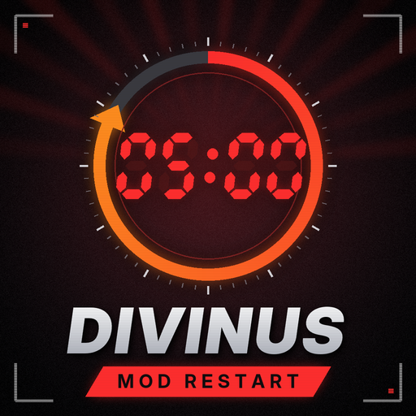

<p align="center">
  
</p>

<h1 align="center">DivinuS Mod Restart</h1>

<p align="center">
  Automatic restart for <b>DayZ</b> servers with an on-screen warning, siren and safe logout, done entirely inside the mod.<br>
  <a href="README.md">Versão em português</a>
</p>

---

## About

**DivinuS Mod Restart** restarts your server at the times you choose and prepares the players first. It shows a warning at the top of the screen and plays a siren. Close to the restart, it makes the character sit down and leave through the normal DayZ logout. The character is saved before the restart, so nobody loses items to a rollback.

The mod does not use CFTools or `messages.xml` and needs no external program. All settings live in one file: `profiles/restart/restart.json`.

## Features

- Restart at fixed times (`04:00`, `08:00`...) or by interval (every X minutes).
- Centered warning inside a bordered box. The countdown is in minutes, then in seconds during the last minute, with blinking text.
- Siren before the restart, which can loop until restart time.
- Safe logout: the character sits down and goes through DayZ's own logout screen (the same as the **Exit** button). The character is saved at the end.
- Players who join or cancel the logout during this period get the logout again.
- At restart time, the server saves anyone still online before closing.
- Two restart modes: `REINICIAR` (the game closes and starts again) or `DESLIGAR` (shutdown only, for hosts that restart the server automatically).
- Texts, colors, sizes, position, border and background of the warning are configurable.
- One setting turns the restart on and off.
- No dependency on CF or any other mod.

## How it works (default settings)

| Time left | What happens |
|---|---|
| 5 min | The warning `RESTART DO SERVIDOR EM 5 MIN` appears |
| 3 min | The siren plays |
| 2 min | The character sits down and the DayZ logout starts (15 s). At the end the character is saved and disconnected |
| 1 min | The countdown switches to seconds and the text blinks |
| 0:00 | The server saves anyone left and restarts |

---

## Installation

### Server

1. Copy the `@DivinuS_Mod_Restart` folder to the server folder. You get it from the Steam Workshop or from the Releases page.
2. Add the mod to the server's `-mod=` launch parameter, separated from other mods by `;`:
   ```
   -mod=@CF;@OtherMod;@DivinuS_Mod_Restart
   ```
   Use `-mod=` and **not** `-serverMod=`. Players need the mod to see the warning, hear the siren and sit down.
3. Copy the `.bikey` from `@DivinuS_Mod_Restart/keys` to the server `keys` folder.
4. Start the server once. The mod creates `<profile folder>/restart/restart.json` by itself. The `<profile folder>` is the folder set in `-profiles=`.
5. Edit the file as you like and restart the server.

### Players

Players download the mod from the Steam Workshop or the launcher, like any other server mod.

---

## Configuration

File: `<profile folder>/restart/restart.json`

The setting names are in Portuguese. Do not rename them; only change the values.

```json
{
    "RestartLigado": 1,
    "HorariosDeRestart": ["00:00", "04:00", "08:00", "12:00", "16:00", "20:00"],
    "IntervaloEmMinutos": 0,
    "ComoReiniciar": "REINICIAR",
    "MinimoMinutosLigado": 10,
    "AvisoFaltandoMinutos": 5,
    "SireneFaltandoMinutos": 3,
    "RepetirSirene": 0,
    "LogoutFaltandoMinutos": 2,
    "SentarAntesDoLogout": 1,
    "SegundosDoLogout": 15,
    "TextoMinutos": "RESTART DO SERVIDOR EM %1 MIN",
    "TextoSegundos": "RESTART DO SERVIDOR EM %1 SEG",
    "TextoLogout": "SALVANDO SEU PERSONAGEM PARA O RESTART",
    "TextoReiniciando": "REINICIANDO O SERVIDOR...",
    "CorDoTexto": [255, 40, 40],
    "TamanhoDoTexto": 28,
    "DistanciaDoTopo": 100,
    "PiscarNoUltimoMinuto": 1,
    "MostrarCaixa": 1,
    "LarguraDaCaixa": 620,
    "EspessuraDaBorda": 2,
    "CorDaBorda": [255, 40, 40],
    "OpacidadeDoFundo": 60
}
```

### Settings

**On / off**

| Setting | Default | What it does |
|---|---|---|
| `RestartLigado` | `1` | `1` = on. `0` = off (no warning and no restart) |

**When to restart**

| Setting | Default | What it does |
|---|---|---|
| `HorariosDeRestart` | `["00:00", "04:00", ...]` | Restart times on the server PC clock, in `HH:MM` format |
| `IntervaloEmMinutos` | `0` | Only used when the time list is empty. Restarts X minutes after the server starts (`0` = no restart) |
| `MinimoMinutosLigado` | `10` | If the server has just started, skips a restart time that would come sooner than this (0 to 120) |

**How to restart**

| Setting | Default | What it does |
|---|---|---|
| `ComoReiniciar` | `"REINICIAR"` | `"REINICIAR"` = the game closes and starts again. `"DESLIGAR"` = shutdown only. If the chosen mode does not close the server, the mod tries the other one after 60 seconds |

**Timings (minutes before the restart)**

| Setting | Default | What it does |
|---|---|---|
| `AvisoFaltandoMinutos` | `5` | When the warning appears (1 to 60) |
| `SireneFaltandoMinutos` | `3` | When the siren plays (`0` = no siren) |
| `RepetirSirene` | `0` | `1` = loop the siren until the restart |
| `LogoutFaltandoMinutos` | `2` | When the logout starts (`0` = no logout, max 30) |
| `SentarAntesDoLogout` | `1` | `1` = the character sits down before the logout |
| `SegundosDoLogout` | `15` | Length of the DayZ logout screen, in seconds (5 to 60) |

**Texts** (`%1` becomes the number). The defaults are in Portuguese; see the examples below for English.

| Setting | Default | When it shows |
|---|---|---|
| `TextoMinutos` | `RESTART DO SERVIDOR EM %1 MIN` | Countdown in minutes |
| `TextoSegundos` | `RESTART DO SERVIDOR EM %1 SEG` | Last minute |
| `TextoLogout` | `SALVANDO SEU PERSONAGEM PARA O RESTART` | During the logout |
| `TextoReiniciando` | `REINICIANDO O SERVIDOR...` | At restart time |

**Look**

| Setting | Default | What it does |
|---|---|---|
| `CorDoTexto` | `[255, 40, 40]` | Text color in R, G, B (0 to 255) |
| `TamanhoDoTexto` | `28` | Text height in pixels (10 to 80) |
| `DistanciaDoTopo` | `100` | Distance from the top of the screen in pixels |
| `PiscarNoUltimoMinuto` | `1` | `1` = the text blinks during the last minute |
| `MostrarCaixa` | `1` | `1` = dark box with border. `0` = text only |
| `LarguraDaCaixa` | `620` | Box width in pixels (100 to 1600) |
| `EspessuraDaBorda` | `2` | Border thickness in pixels (`0` = no border, max 10) |
| `CorDaBorda` | `[255, 40, 40]` | Border color in R, G, B |
| `OpacidadeDoFundo` | `60` | `0` = transparent background. `100` = black background |

### Important rules

- Edit the file in an editor such as Notepad++ and do not remove quotes or commas.
- The `LEIA_1` to `LEIA_5` fields are only help text and can stay in the file.
- The file is read when the server starts. After any change, restart the server.
- If the file has a typo, the restart is turned **off** and the log shows `ERRO ao ler profiles/restart/restart.json`. Fix it and restart the server.
- Values outside the allowed range are adjusted automatically to the nearest minimum or maximum.

---

## Examples

**Restart every 3 hours, starting at midnight**
```json
"HorariosDeRestart": ["00:00", "03:00", "06:00", "09:00", "12:00", "15:00", "18:00", "21:00"],
"IntervaloEmMinutos": 0,
```

**Restart every 6 hours, counted from when the server starts**
```json
"HorariosDeRestart": [],
"IntervaloEmMinutos": 360,
```

**Host that restarts the server automatically**
```json
"ComoReiniciar": "DESLIGAR",
```

**Warning only, no siren and no logout**
```json
"SireneFaltandoMinutos": 0,
"LogoutFaltandoMinutos": 0,
```

**English texts**
```json
"TextoMinutos": "SERVER RESTART IN %1 MIN",
"TextoSegundos": "SERVER RESTART IN %1 SEC",
"TextoLogout": "SAVING YOUR CHARACTER FOR THE RESTART",
"TextoReiniciando": "RESTARTING THE SERVER...",
```

**Yellow warning, no box**
```json
"CorDoTexto": [255, 200, 0],
"MostrarCaixa": 0,
```

---

## Testing

To see the whole cycle in 10 minutes, leave the time list empty and use the interval:

```json
"HorariosDeRestart": [],
"IntervaloEmMinutos": 10,
```

Restart the server and join the game. Times count from when the server finishes loading:

| Time | What should happen |
|---|---|
| 5 min | The warning appears |
| 7 min | The siren plays |
| 8 min | The character sits down and leaves through the logout screen |
| 10 min | The server restarts |

After the test, put your restart times back and set `"IntervaloEmMinutos": 0`. Otherwise the server restarts every 10 minutes.

## Logs

The mod writes to the server script log (`script_*.log`, in the profile folder). Every line starts with `[DivinuS_Restart]`. The log messages are in Portuguese:

```
[DivinuS_Restart] profiles/restart/restart.json carregado.
[DivinuS_Restart] Restart LIGADO. Modo de reinicio: REINICIAR
[DivinuS_Restart] Proximo restart em 10 minutos.
[DivinuS_Restart] Logout para o restart: PlayerName (15 s)
[DivinuS_Restart] HORA DO RESTART. Salvando jogadores e reiniciando em 5 segundos.
[DivinuS_Restart] Reiniciando o servidor (RequestRestart). Tentativa 1
```

| Log text | Meaning |
|---|---|
| `carregado` | Config file loaded |
| `Restart LIGADO` / `DESLIGADO` | Restart is on / off |
| `Proximo restart em X minutos` | Next restart in X minutes |
| `Logout para o restart` | Logout started for this player |
| `HORA DO RESTART` | Restart time: saving players |
| `Reiniciando` / `Desligando` | Restarting / shutting down the server |

---

## Using it on a game host

- A mod cannot start a server that is already off. If your host restarts the server when it closes, use `"ComoReiniciar": "DESLIGAR"` and keep the panel's auto-restart on.
- Turn off other scheduled restarts (CFTools, host panel) so the server does not restart twice.
- Restart times follow the server machine's clock. Check the host's time zone.
- Before using it for real, run the 10-minute test above.

## Troubleshooting

| Problem | What to do |
|---|---|
| The warning does not show | Check that the mod is in `-mod=` (not `-serverMod=`) and `RestartLigado` is `1`. Look for `ERRO` in the `[DivinuS_Restart]` log lines |
| The log shows `ERRO ao ler profiles/restart/restart.json` | A quote or comma is missing or extra in the file. Fix it and restart the server |
| The log shows `Horario invalido ignorado` | Use the `HH:MM` format, for example `"04:00"` |
| The restart happens at the wrong time | The mod uses the server PC clock. Check the machine's or host's time zone |
| The server restarts twice | Another restart is scheduled (CFTools or panel), or the mod is loaded twice. Keep only one |
| The server closes and does not come back | On a host, use `DESLIGAR` and turn on the panel's auto-restart |
| I changed the file and nothing changed | The file is only read when the server starts. Restart the server |


## Credits

**Author:** DivinuS
